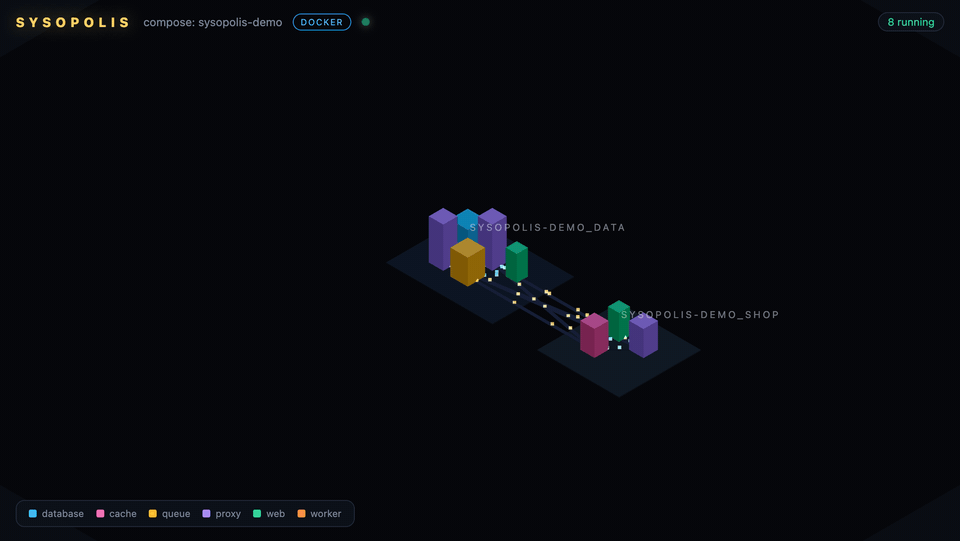
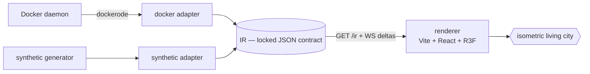

# 🏙️ Sysopolis

[](https://github.com/mkarki/sysopolis/actions/workflows/ci.yml)
[](LICENSE)

> **Your infrastructure, as a living city.**
> Point it at your stack. Watch it come alive.

Sysopolis turns a running, heterogeneous information system into a living isometric city
you can explore. Each system is a **building**, each network is a **district**, each
connection is a **road** — and real traffic flows down those roads as light. When a
service degrades or dies, its building goes dark and its traffic stops: you *feel* the
outage instead of reading a dashboard.

<!-- TODO: demo GIF — `docker stop payments` → the payments building goes dark, live -->


## Why it's different

Prior art visualizes **static source code** as cities (CodeCity, JSCity, SoftVis3D) or
draws **flat node-link graphs** for network monitoring. Sysopolis renders a **live,
running system as a walkable ops-city** where health and traffic are the gameplay.

The core design is the seam:

```
adapter  →  intermediate representation (IR)  →  living city
```

Swap the adapter (Docker today; nmap / k8s / Terraform tomorrow) — the city stays the same.

## Quick start

**Synthetic mode** — no Docker needed, a large fake enterprise with live incidents:

```bash
npm install
npm run demo
```

**Docker mode** — mirror your actual containers:

```bash
docker compose -f examples/demo-stack/docker-compose.yml up -d
npm run demo:docker
```

Then kill something and watch the city react:

```bash
docker stop sysopolis-demo-payments-1
```

The `payments` building goes dark, its roads stop glowing. `docker start` it and the
lights come back.

## What you get

- **Isometric 2.5D city** — React-Three-Fiber + orthographic camera, pan/zoom, click a
  building for a live inspector panel (status, CPU, memory, network I/O, neighbors).
- **Live layer** — the collector serves the IR once (`GET /ir`) then streams deltas over
  WebSocket. Building colors track health (`running` / `starting` / `unhealthy` /
  `exited`) in real time; animated light-particles flow along roads, scaled by traffic.
- **Two adapters** —
  - `--docker`: introspects containers, networks, health and stats via the Docker API
    (dockerode), including live `docker events`.
  - `--synthetic`: a deterministic fake enterprise (53 systems, 9 districts) with a
    rolling incident simulator — perfect for demos and renderer development.

## Architecture



| Package | Role |
| --- | --- |
| [`@sysopolis/core`](packages/core) | The IR schema + validator, image→kind classification, deterministic city layout, synthetic generator. Zero dependencies. |
| [`@sysopolis/collector`](packages/collector) | Node server: builds the IR (docker or synthetic), serves `GET /ir`, streams live patches over `ws://…/ws`. |
| [`@sysopolis/app`](packages/app) | The renderer: instanced buildings, district blocks, roads, particle traffic, inspector. |

### The IR — the contract everything hinges on

Adapters write it, the renderer reads it, the live layer patches it:

```jsonc
{
  "meta":      { "source": "docker" | "synthetic", "name": "...", "generatedAt": "..." },
  "districts": [ { "id": "...", "label": "...", "kind": "network" } ],
  "systems":   [ { "id": "...", "label": "...", "districtId": "...",
                   "kind": "database|cache|queue|proxy|web|worker|unknown",
                   "image": "...", "footprint": 0.7, "height": 0.4, "status": "running" } ],
  "links":     [ { "id": "...", "source": "...", "target": "...",
                   "kind": "network|depends_on", "weight": 0.8 } ],
  "metrics":   { "<systemId>": { "status": "...", "cpu": 21, "memPct": 25,
                                 "netInBps": 3600000, "netOutBps": 3300000 } }
}
```

Validate any IR with the bundled validator: `npm run gen` generates a synthetic
`city.json` and checks it against the contract.

### Mapping rules (deterministic — same IR in, same city out)

- **system = container**, **district = its first user-defined docker network**
- **kind** = substring match on the image name → building color
- **footprint** = log-scaled image size · **height** = connection count (hubs tower)
- **districts** sit on a spiral from the center; buildings fill blocks row-major by id
- big networks collapse to a **district ring road** instead of an O(n²) mesh; only
  cross-network links become inter-district roads

### Traffic — the honest approximation

Docker exposes per-container net I/O, not per-link flow. So: in synthetic mode links
carry exact weights and roads glow precisely; in docker mode a system's `netOutBps` is
split across its outgoing roads — *a busy building lights up the roads leaving it*. Any
road whose endpoints are both alive keeps a baseline pulse; an `exited` endpoint kills
the flow.

## Roadmap (v2)

- [ ] Real network discovery (nmap / subnet scan) adapter
- [ ] k8s / Terraform / CMDB adapters — the IR makes them cheap
- [ ] Security overlay: CVE mapping, attack paths, burning buildings
- [ ] Multi-host, auth, persistence, first-person walkable camera

## Contributing

PRs welcome — the most valuable contributions are **new adapters**: anything that can
emit the IR gets a city for free. Run `npm run typecheck` before pushing; CI builds the
app and validates the synthetic IR on every PR.

## License

[MIT](LICENSE)
